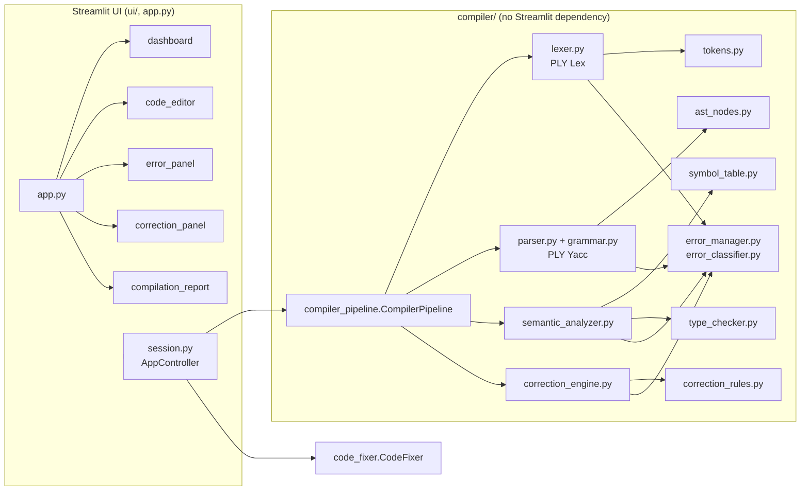
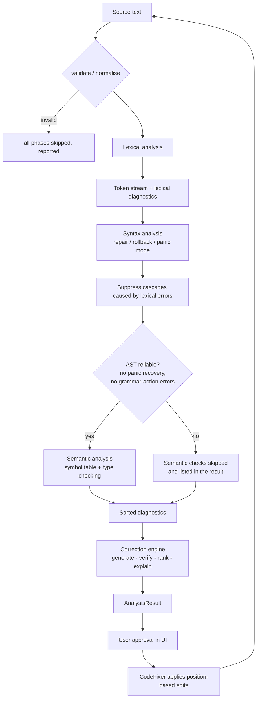
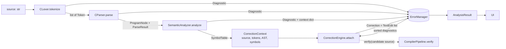
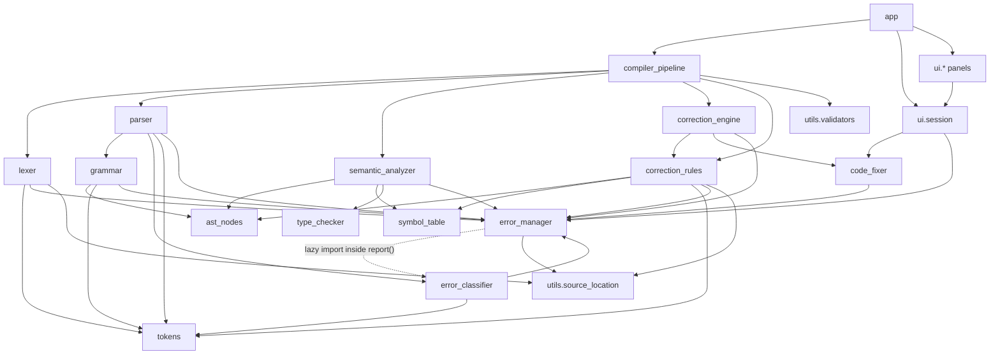

# Architecture

All diagrams below reflect the code as implemented (module names are real files).

## 1. System architecture

## 2. Compiler pipeline (what `CompilerPipeline._run` does)

## 3. Data flow

## 4. Module dependency diagram (generated from the real imports)

`ast_nodes`, `tokens`, `symbol_table`, `type_checker`, `source_location`, `validators` and `code_diff`
depend on nothing else in the project.

## 5. Design decisions

* **Frontend/back-end separation.** `compiler/` never imports Streamlit. All UI state transitions (analyse,
  apply, reject, undo, reset, batch apply) live in `ui/session.py` on top of a `MutableMapping`
  (`st.session_state` in the app, a `dict` in tests), so Streamlit reruns cannot lose code or decisions.
* **PLY is optional for import, mandatory for use.** `compiler/__init__.py` exports lazily, so the
  semantic analyzer, correction engine and code fixer can be imported and tested without PLY.
* **Diagnostics are data.** Every phase reports through `ErrorManager.report(kind, ...)`; the catalogue in
  `error_classifier.py` maps a *kind* to its ID/category/severity. Each diagnostic carries a machine-readable
  `context` dict (offsets, expected tokens, visible symbols, types) used by the correction rules.
* **Corrections are offset-based `TextEdit`s** against the exact analysed text (hash-checked), never global
  string replacement.
* **Thread safety.** The PLY lexer/parser objects are stateful; `CompilerPipeline` guards `analyze`/`verify`
  with an `RLock` because Streamlit sessions run in threads and share the cached pipeline.
* **Deliberate deviations from the suggested layout:** added `ui/session.py` (framework-free state logic),
  `pytest.ini`, and `tests/helpers.py`. No other structural changes.
